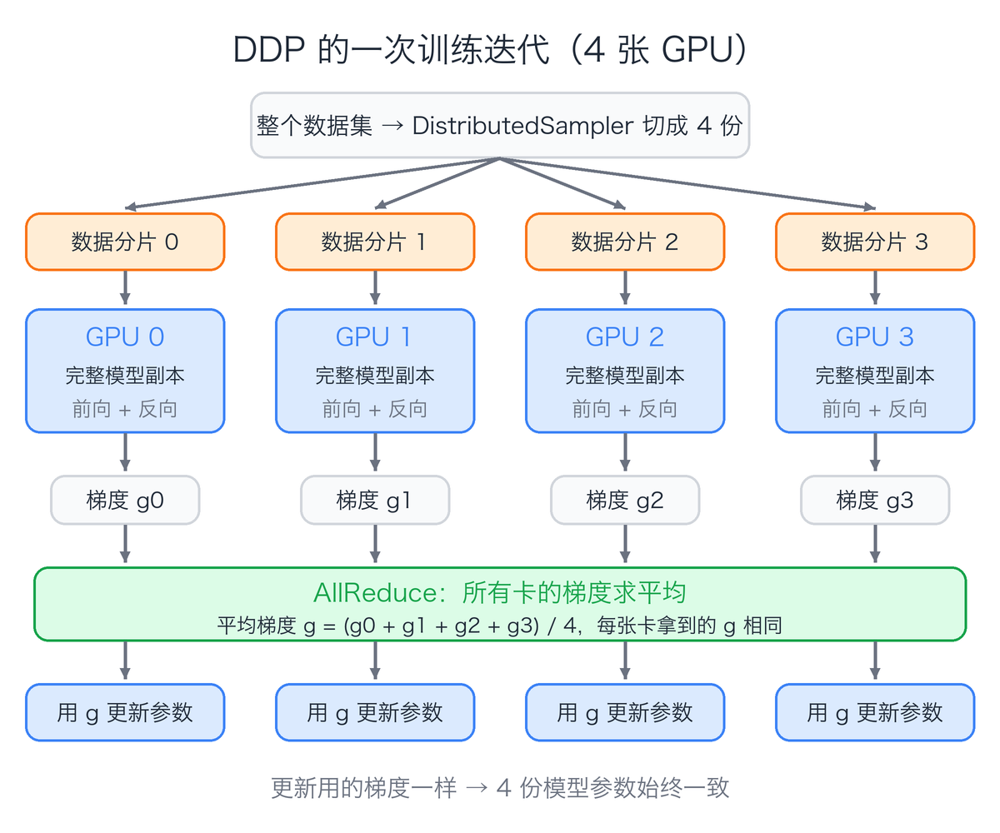
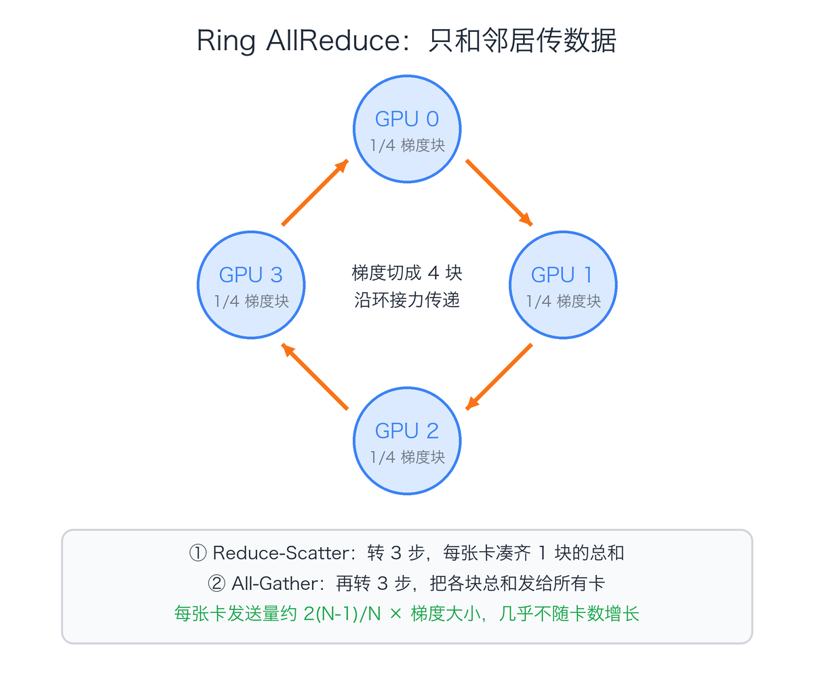

{{size:74| {{color:#3b82f6|数据并行}} DDP 介绍}}
一张 GPU 训练太慢，最直接的办法是**多叫几张卡一起干**。

{{bg:#dbeafe|**数据并行**}}：每张卡放一份完整的模型，各自吃不同的数据，最后把学到的东西合在一起。PyTorch 里最常用的实现就是 **DDP**（DistributedDataParallel）。

## {{color:#3b82f6|01}} DDP 是什么

- 每张 GPU 由一个**独立进程**负责
- 每个进程都有一份**完整的模型副本**
- 每个进程只读**自己那一份数据**
- 每一步反向传播后，所有卡的**梯度求平均**

> 梯度一样，参数就一样。DDP {{color:#3b82f6|**只同步梯度**}}，不需要同步参数。

## {{color:#3b82f6|02}} 一次迭代发生了什么

1. **广播**：启动时，0 号进程把初始参数发给所有卡，保证起点一致
2. **切数据**：{{bg:#f3f4f6|DistributedSampler}} 把数据集切成 N 份，每张卡拿一份
3. **各算各的**：各卡独立做前向和反向，算出自己的梯度
4. **求平均**：AllReduce 把所有卡的梯度求平均
5. **同步更新**：每张卡用同一个平均梯度更新参数

单卡 batch 是 32、用 4 张卡时，一步就相当于用 {{bg:#ffedd5|**128 条数据**}}训练。

## {{color:#3b82f6|03}} 梯度怎么求平均

最朴素的做法是全发给一张卡汇总，再发回去。卡一多，这张卡的带宽就成了{{color:#f97316|**瓶颈**}}。

DDP 默认用 NVIDIA 的 NCCL 通信库，常见算法是 {{bg:#dbeafe|**Ring AllReduce**}}：所有卡排成一个环，每张卡只和左右邻居传数据。

每张卡的发送量约为 **2(N-1)/N 倍**梯度大小。
从 4 卡加到 64 卡，这个数从 1.5 倍只涨到约 2 倍，{{color:#16a34a|**几乎不随卡数增长**}}。

## {{color:#3b82f6|04}} 为什么比 DataParallel 快

PyTorch 还有一个老的 DataParallel（DP），一行代码就能用，但{{color:#f97316|**不推荐**}}：

| 对比 | DP | DDP |
| --- | --- | --- |
| 进程 | 单进程多线程，受 GIL 限制 | 每张卡一个进程 |
| 模型复制 | 每一步都从 0 号卡复制 | 只在启动时广播一次 |
| 负载 | 输出和梯度都堆在 0 号卡 | 各卡均衡 |
| 多机 | 只能单机 | 可以跨多台机器 |

## {{color:#3b82f6|05}} 通信和计算同时进行

DDP 不会等整个反向传播结束才开始通信。

它把梯度按大小分成若干个{{bg:#dbeafe|**桶**}}（默认每桶约 25MB）。

反向传播从最后一层往前算，某个桶的梯度一算完，就立刻对它做 AllReduce，同时继续算前面层的梯度。

> 大部分通信时间被计算{{color:#3b82f6|**掩盖**}}掉，多卡加速比更接近卡数。

## {{color:#3b82f6|06}} 上手只要改几处

1. 初始化进程组：{{bg:#f3f4f6|dist.init_process_group("nccl")}}
2. 绑定显卡：{{bg:#f3f4f6|torch.cuda.set_device(local_rank)}}
3. 包一层模型：{{bg:#f3f4f6|model = DDP(model, device_ids=[local_rank])}}
4. 数据加载换成 {{bg:#f3f4f6|DistributedSampler}}
5. 启动：{{bg:#f3f4f6|torchrun --nproc_per_node=4 train.py}}

torchrun 会为每张卡启动一个进程，并通过环境变量 RANK、LOCAL_RANK 告诉它自己是第几号。

## {{color:#3b82f6|07}} 常见的坑

- {{color:#f97316|**忘了 sampler.set_epoch(epoch)**}}：每一轮数据顺序都一样，等于没打乱
- {{color:#f97316|**每个进程都在存模型、打日志**}}：只让 rank 0 做，否则文件互相覆盖、日志刷屏
- {{color:#f97316|**学习率没跟着调**}}：全局 batch 变成单卡的 N 倍，通常要调大学习率并加 warmup
- {{color:#f97316|**BatchNorm 各算各的**}}：单卡 batch 很小时，换成 SyncBatchNorm
- {{color:#f97316|**有参数没参与计算就报错**}}：可以设 find_unused_parameters=True，但会变慢，能改模型就别开

## {{color:#3b82f6|08}} 什么时候不够用

DDP 要求每张卡放得下**一整份模型、梯度和优化器状态**。

模型大到单卡放不下时，就要换成 FSDP、ZeRO 这类把参数切开存的方案，或者张量并行、流水线并行。

## 一句话总结

> {{bg:#dbeafe|**DDP = 多进程 + 每卡一份模型 + 每步 AllReduce 平均梯度**}}
> 模型放得下单卡时，它是多卡训练的首选。
